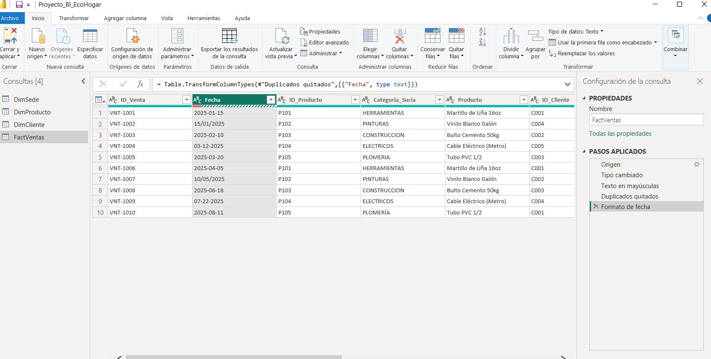
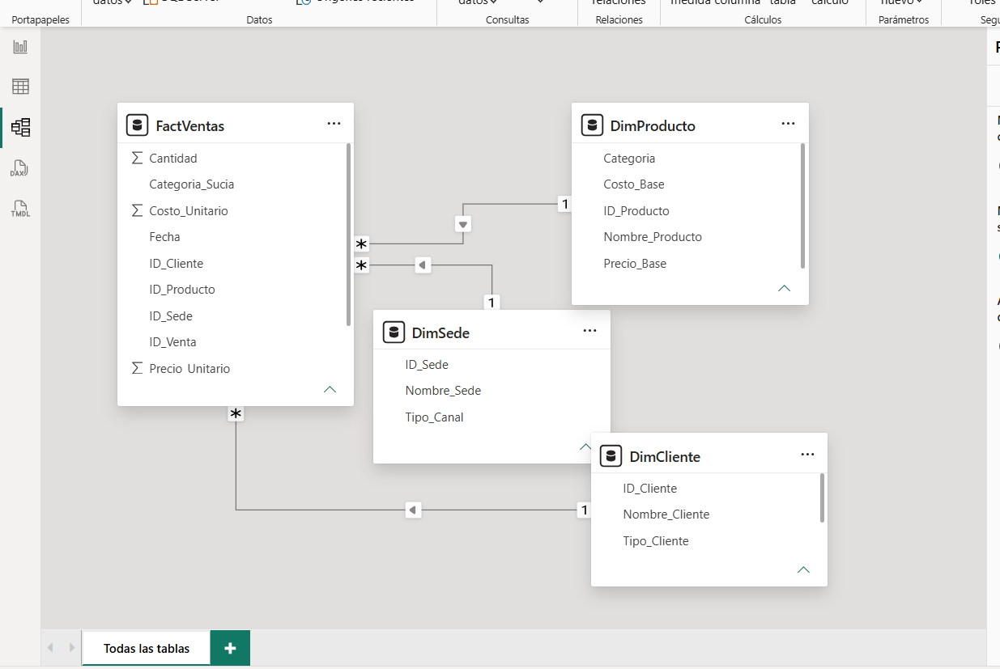
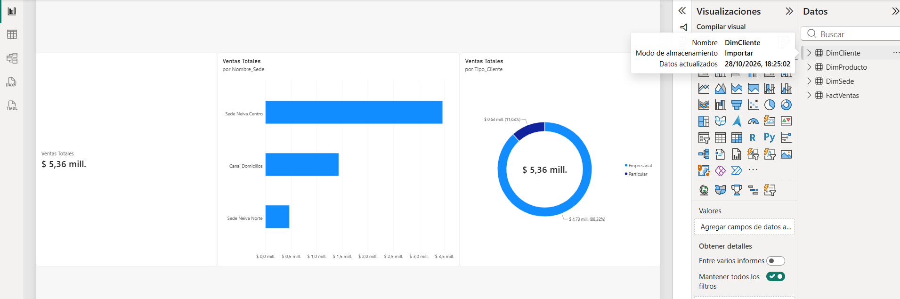

# Actividad Calificable Corte 3: Dashboard Interactivo con Narrativa

- **Estudiante:** Larissa Alexandra Molina Borja  
- **Asignatura:** Inteligencia de Negocios — CORHUILA  
- **Docente:** Jesús Ariel González Bonilla  
- **Semana:** 12-week (Corte 3 - Semana 4)  
- **Dataset Aplicado:** EcoHogar del Huila  

---

## 1. Visuales y Buenas Prácticas Aplicadas
- **Tarjeta KPI Principal:** Visualización directa del volumen global de Ventas Totales ($ 5,36 mill.).
- **Gráfico de Barras Horizontales:** Comparativa de Ventas Totales por Sede/Canal (`Nombre_Sede`), destacando el liderazgo operativo de *Sede Neiva Centro*, seguido de *Canal Domicilios* y *Sede Neiva Norte*.
- **Gráfico de Anillo:** Distribución porcentual y monetaria por `Tipo_Cliente` (Empresarial vs. Particular) manteniendo una baja densidad de tinta y etiquetas de datos claras.

---

## 2. Elementos de Interactividad
- **Segmentadores e Interacción:** Filtrado dinámico habilitado a través de las dimensiones relacionales (`DimCliente`, `DimProducto`, `DimSede`).
- **Modelo Relacional:** Esquema en Estrella que permite la propagación de filtros desde las dimensiones hacia la tabla de hechos `FactVentas`.
- **Filtrado Cruzado:** Sincronización interactiva entre el gráfico de anillo y el gráfico de barras al hacer clic en los segmentos.

---

## 3. Narrativa de Negocio (3 Momentos)
1. **Contexto:** Evaluación del desempeño transaccional comercial de EcoHogar del Huila alcanzando un total consolidado de **$ 5,36 millones** en ventas.
2. **Hallazgo (Dato Resaltado):** El segmento de clientes **Empresarial representa la gran mayoría de los ingresos con un 88.32% ($ 4,73 mill.)**, mientras que los clientes Particulares aportan el 11.68% ($ 0,63 mill.).
3. **Recomendación:** Priorizar las alianzas comerciales B2B y fortalecer la capacidad de atención en la Sede Neiva Centro y el Canal Domicilios para el primer trimestre de 2026.

---

## 4. Dashboard & Insight (English Section)
This interactive Business Intelligence dashboard evaluates the sales performance metrics for EcoHogar del Huila using a star schema data model. Total revenue reached $5.36 million, driven primarily by corporate operations across physical and delivery channels. A key insight reveals that Corporate customers ("Empresarial") generate 88.32% of total sales revenue ($4.73 million), while retail individual customers represent only 11.68% ($0.63 million). Cross-filtering capabilities allow dynamic exploration across branches, with Neiva Centro leading overall branch performance. Therefore, management should focus Q1 2026 promotional strategies on retaining high-volume corporate clients while optimizing delivery logistics.

---

## 5. Capturas de Evidencia

### Limpieza de Datos (Power Query)

### Modelo de Datos (Estrella)

### Dashboard Final e Interactividad

